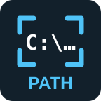

# ShareX Clip for Stream Deck

Two Stream Deck buttons for [ShareX](https://getsharex.com/) region capture that differ only in what lands on your clipboard:

| Key | Action | Clipboard after capture |
| --- | --- | --- |
|  | **Region → File Path** | The saved file's full path, as text |
|  | **Region → Image** | The image itself |

The path button is for tools that take a file path rather than a pasted image, such as Claude Code in a terminal. The image button is for everything else.

Both buttons also save the screenshot to your normal ShareX screenshots folder.

## Requirements

- Windows 10 or later
- Stream Deck app 7.1 or later
- ShareX, installed in `C:\Program Files\ShareX` or `%LOCALAPPDATA%\Programs\ShareX`
- [Node.js](https://nodejs.org/) 18 or later, only for the one-time setup script

## Install

1. Download this repository (**Code → Download ZIP**, then extract) or clone it.

2. Copy the `com.dev.sharexclip.sdPlugin` folder into your Stream Deck plugins folder:

   ```
   %APPDATA%\Elgato\StreamDeck\Plugins
   ```

3. Quit ShareX completely (right-click its tray icon → **Exit**). ShareX rewrites its config when it closes, so it must not be running for the next step.

4. From the repository folder, add the two ShareX workflows:

   ```
   node setup-sharex-workflows.js
   ```

   This adds two entries with no hotkey bound to `Documents\ShareX\HotkeysConfig.json`, and saves the previous file next to it as `HotkeysConfig.json.pre-streamdeck.bak`. Your existing hotkeys are not changed. Running it again is safe.

   If your ShareX config lives elsewhere (a portable install, or a custom personal folder), pass the file's path:

   ```
   node setup-sharex-workflows.js "D:\ShareX\HotkeysConfig.json"
   ```

5. Start ShareX again, and restart the Stream Deck app (right-click its tray icon → **Quit Stream Deck**, then reopen it).

6. In the Stream Deck app, find the **ShareX Clip** category in the action list and drag **Region → File Path** and **Region → Image** onto keys.

## How it works

Each button runs `ShareX.exe -workflow "<name>"`. The two workflows the setup script creates are both region captures, each with its own after-capture tasks:

| Workflow name | After-capture tasks |
| --- | --- |
| `SD Region - File Path` | Save image to file, Copy file path to clipboard |
| `SD Region - Image` | Copy image to clipboard, Save image to file |

ShareX does the capture and the clipboard work; the plugin only triggers it. That means you can change either workflow in **ShareX → Hotkey settings**, for example to add an upload step or open the image editor.

If you would rather not run the script, create the two workflows by hand in **Hotkey settings** with the names and tasks above.

## Troubleshooting

- **A key shows a yellow alert triangle.** The plugin could not find `ShareX.exe` in either location listed under Requirements.
- **A key does nothing.** The workflow name is missing or was renamed. The buttons find the workflows by name, so the names in ShareX's Hotkey settings must match the table above exactly. Re-run the setup script with ShareX closed.
- **The workflows disappeared.** The script was run while ShareX was open, and ShareX overwrote the file when it closed. Quit ShareX and run it again.
- **Log file.** The plugin writes to `logs\plugin.log` inside its installed folder.

## Uninstall

Delete `com.dev.sharexclip.sdPlugin` from the Stream Deck plugins folder and restart Stream Deck, then delete the two `SD Region` entries in ShareX's Hotkey settings.

---

Not affiliated with ShareX or Elgato.
